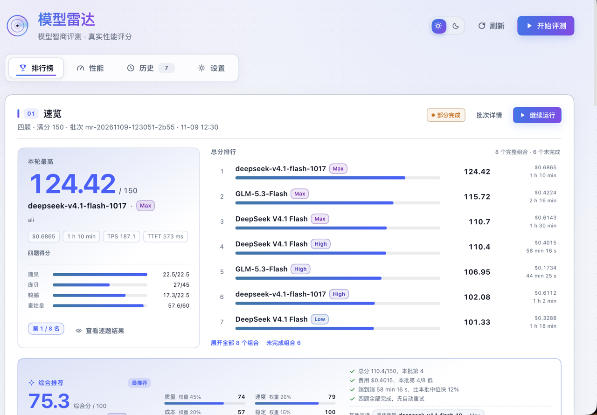
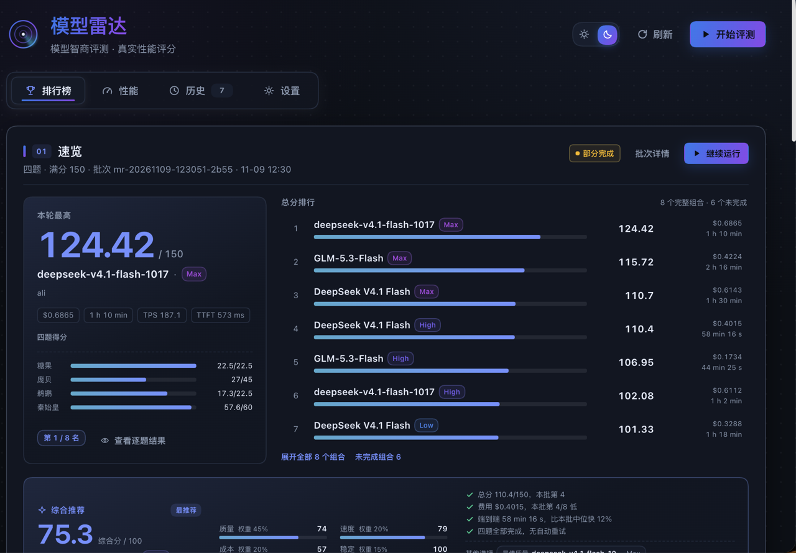
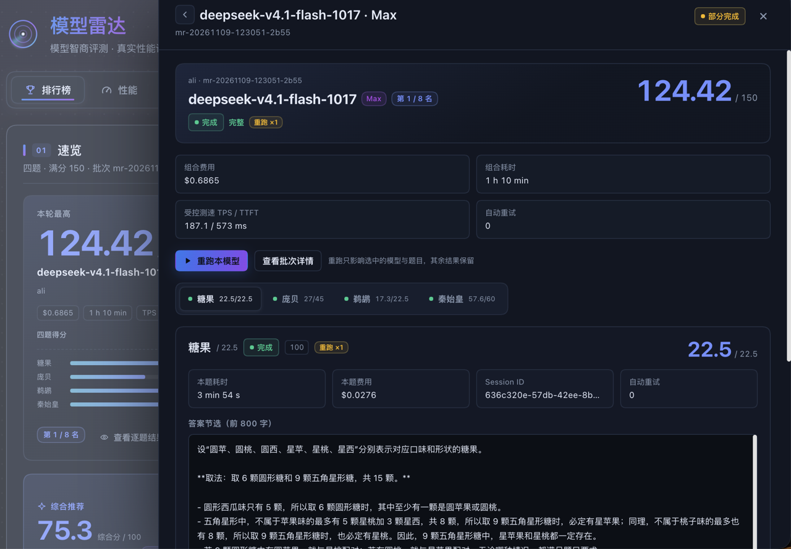
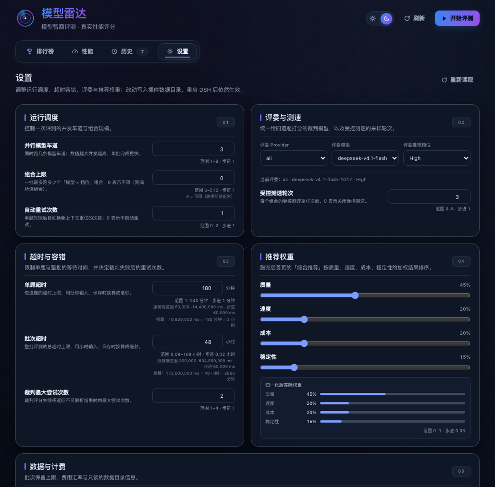
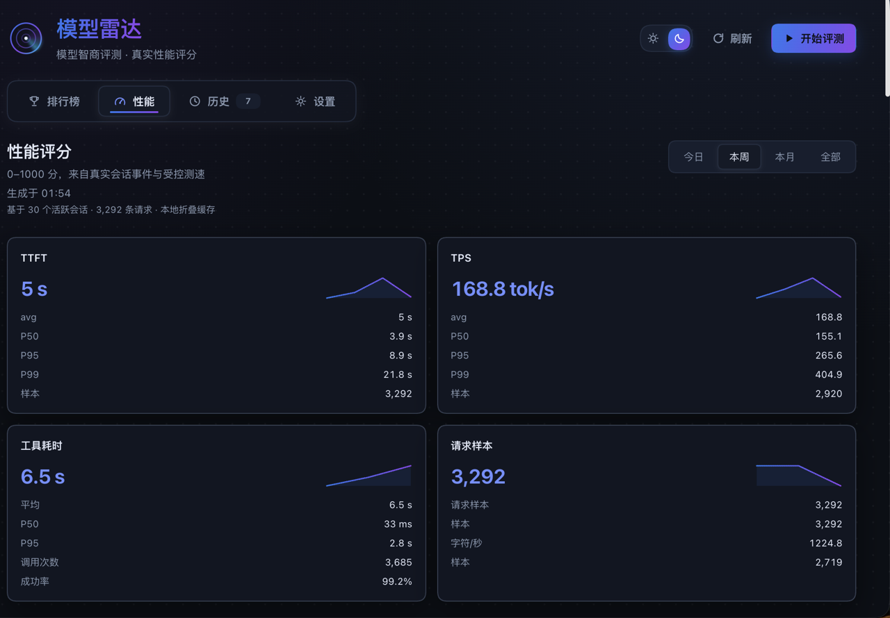

# dsh-model-radar (Model Radar)

English | [简体中文](README.md)

A standalone DeepSeek Harness (DSH) plugin: a **four-task, 150-point model intelligence benchmark** plus **real-world performance scoring per model × reasoning effort**.

- Pick the model × reasoning-effort combinations yourself and run the codexradar-style four tasks: Qin 60 / Pompeii 45 / Pelican 22.5 / Candy 22.5.
- In every batch the **judge model** runs as the batch's main session; each candidate model runs as a **subagent** in a fresh session with its own working directory, and results flow back to the main model, which writes the batch summary when the batch finishes.
- Automatic scoring: Pompeii and Candy are scored programmatically; Qin and Pelican are rubric-scored by the judge model.
- Also includes a 0–1000 real-world performance score (TTFT / TPS / reasoning speed / tool cadence / tool latency / tool success rate / cache hit) with baseline deltas, controlled speed runs, percentiles and a session speed board.

> Session folding and the performance implementation are built in. The plugin depends on no other plugin and does not change the host's model configuration.

## Preview

| Ranking (light) | Ranking (dark) |
|---|---|
|  |  |

| Model detail (single model × four task tabs + artifact preview) | Settings |
|---|---|
|  |  |



> Screenshots use real benchmark data.

## Credits & Prior Art

The plugin's **product shape and scoring ideas reference** two public projects, with thanks. This project is not affiliated with either of them and does not copy their repository code; the set of four tasks follows their published format, while the scoring logic and evaluation code are an independent implementation in this repository.

- **[Codex Radar](https://codexradar.com/)** (open community client: [codex-radar/dradar](https://github.com/codex-radar/dradar)): scoring models on real tasks on a 0–150 "IQ" scale, showing results per model × reasoning effort, and the "model does the work, artifacts can be inspected" evaluation format — including a Pompeii-style jigsaw task — inspired this plugin's task organisation, IQ leaderboard / effort matrix and artifact visualisation. The set of four tasks follows their published format; the scoring logic and evaluation code are an independent implementation here.
- **[Agent Speed](https://github.com/zoefix/agent-speed)** (MIT): the 0–1000 performance score, its seven dimensions (output speed / first-token latency / reasoning speed / tool cadence / tool latency / tool success rate / cache hit) and the idea of computing real-world performance from local session logs directly inspired this plugin's performance module; `lib/perf.js` is an independent implementation in this repository.
- **Pompeii assets**: the puzzle image and the reference assembly are generated by this repository — the underlying fresco is the public-domain *Still life with eggs, birds and bronze dishes* (House of Julia Felix, Pompeii, 50–79 CE) from Wikimedia Commons; the fragment cut, card layout and gold adjacency are computed by this project. See [`assets/pompeii/SOURCE.md`](assets/pompeii/SOURCE.md).
- Thanks to **DeepSeek Harness** for the plugin runtime, theme tokens, session queries and subagent capabilities.

> Names, links and screenshots are used for attribution and provenance only; they do not imply endorsement of this plugin by the projects above.

## License & assets

- Code, UI and documentation: MIT (see [`LICENSE`](LICENSE)).
- Pompeii puzzle image, reference assembly and gold adjacency: generated by this repository; the underlying fresco is a public-domain Wikimedia Commons work — see [`assets/pompeii/SOURCE.md`](assets/pompeii/SOURCE.md) for source and processing.

## Interface

Sidebar "Model Radar" opens a full page with four views. The interface uses a mission-control style (blue-purple tech palette, radar sweep, number roll, heat grids, dot-matrix loading); the sun/moon theme toggle in the top-right corner redraws the `toggle-flip` structure: it follows the host theme on first load, and once switched it only affects the plugin and is stored in `localStorage`. All CSS/SVG is drawn in-house; no external UI dependencies.

1. **Ranking** — ordered "conclusion first, evidence second":
   - **Overview**: a **best of this round** card on the left (rolling top score, model × effort, delta against the same version in the previous batch, cost/duration/TPS/TTFT, four-task score bars) and a compact **total ranking** list on the right (7 rows by default, expandable to all, unfinished combinations can be viewed separately).
   - **Recommendation**: a 0–100 composite score from quality (45%), speed (20%), cost (20%) and stability (15%), producing a "most recommended model + reasoning effort" with four reasons and "best quality / best value / fastest" alternatives; weights are adjustable in Settings.
   - **Effort radar** heat matrix (total/four-task tabs, model × reasoning effort, heat colours; clicking a cell opens that model's detail for the task) → batch trend / score × cost / duration Pareto → judge summary → latest batch detail (collapsed by default; model/effort, total, TPS/TTFT, cost, duration, four-task scores, with a direct "rerun…" action) → scoring methodology.
   - **Model detail drawer**: click a ranking row, matrix cell or recommendation card to open the single-model view — total score and rank, cost/duration/TPS/TTFT/retries at the top, four task tabs, and per task: status / score / judge reason / first 800 characters of the answer / scoring detail / isolation audit. Tasks with artifacts render inline previews (SVG/PNG images, HTML iframe, source toggle) and can also be opened in a dialog or a new tab. "Rerun this model" and "rerun this task" sit at the bottom. In batch-detail mode the drawer lists every combination of that batch; clicking one opens the single-model view.
2. **Performance**: range switch (today / this week / this month / all), 0–1000 score card and seven-dimension bars per combination, baseline delta, controlled speed-run table, TTFT/TPS averages with P50/P95/P99, tool latency, request sample counts and a session speed board. The report only loads when this view is opened (60 s in-memory cache plus a persistent fold cache keyed on session logs), so it does not slow down the ranking view.
3. **History**: batch list and run details; interrupted / stopped / partial batches are labelled and excluded from trends. **Interrupted batches can be resumed**: a stopped, interrupted or partially completed batch can be resumed from the history row, latest-batch panel or detail drawer; finished tasks are kept and only the remaining tasks are rerun, after which the judge summary is regenerated. **Targeted rerun**: any batch can open the rerun dialog from a history row, the latest-batch panel, the detail drawer or the model detail; pick the combinations and tasks to rerun (failed/unfinished runs are preselected by default) and only those are rerun, leaving every other result untouched.
4. **Settings**: scheduling (parallel models, combination cap, automatic retries), judge and speed runs (provider/model/effort plus controlled speed-run count), timeouts (per task / per batch plus judge attempt cap), recommendation weights (quality/speed/cost/stability, normalised on save) and data & pricing (batch retention, USD→CNY rate). Changes are written to `<dataDir>/settings.json` and take effect immediately (a save during a run applies to the next batch) and can be reset to defaults.

Disabling or reloading the plugin while a batch is running marks the batch as **interrupted** with a reason (visible in the batch detail), and a batch that was still running at restart is migrated to **interrupted** as well — it never quietly becomes "stopped without a reason".

The **Start benchmark** dialog groups models by provider; each model expands into multi-select reasoning-effort chips and shows context window, output limit and image support. **The number of combinations is not capped** (DSH itself has no such limit; at most `maxParallelModels` models run at the same time, and efforts/tasks of the same model run serially). **The judge model is selected independently** (provider → model → effort, defaulting to the configured value), and the footer shows `N combinations × 4 tasks = M runs`. While running, the dialog switches to a progress view with one lane per model, the current task, completed/failed counts, elapsed time and a stop button.

## Scoring (0–100 → weighted 150)

Following codexradar's `codex-four-weighted-150-v2`: each task is first scored on its own **0–100** rubric, then converted to the total with fixed weights:

| Task | Weight | Conversion | Scoring |
| --- | --- | --- | --- |
| Qin (qin) | 60 | `score100 × 0.60` | Judge rubric with 20 items (A1–F4, 100 total), plus 7 core-relationship gates: 2 unmet caps at 59, 1 unmet caps at 69, 2 partially met caps at 69, 1 partially met caps at 79 |
| Pompeii (pompeii) | 45 | `F1 × 100 × 0.45` | Programmatic: adjacency F1 × 100 is the raw score |
| Pelican (pelican) | 22.5 | `score100 × 0.225` | Judge rubric with 14 items (shape 12, legs 4, frame 11, drivetrain 5, seat 6, orientation 4, foot-pedal contact 18, wheel/crank 10, leg-crank 10, body stability 4, framing 5, text 3, craft 5, occlusion readability 3; 100 total) |
| Candy (candy) | 22.5 | 100 × 0.225 if correct, 0 otherwise | Programmatic |

Total = Σ (each task's 0–100 score × weight ÷ 100), maximum 150. Each batch stores both `run.score100` (raw 0–100) and `run.score` (weighted); the detail view shows "0–100 X → weighted Y/weight". For Qin it also shows the result after the core-relationship cap. Task/rubric versions are `mr-four-150-v2` / `mr-rubric-150-v2`; they do not mix with older batches (older batches no longer offer resume and require a new batch). The judge and candidate output budgets are read from the DSH model configuration (the example environment uses 128k; the actual value follows the selected model), never hard-coded; if the judge exceeds its budget or fails to parse, it can retry against a compressed artifact, and artifact text over 100 KB is truncated and marked.

A missing artifact (no `result.svg` / `index.html` / `model_answer.json`) is no longer scored as 0: it is recorded as a `no-artifact` failure and the combination total is left empty, so "did not deliver" and "answered incorrectly" stay distinct. If a model burns its output budget on reasoning and is cut off by max-tokens, the plugin appends one "write the file now" continuation; only if that also fails is the run marked failed.

**Duration does not affect the score**: `durationMs` / TPS are used only on the performance page. Failures outside the model's ability — timeouts, upstream 5xx, judge JSON failures — are therefore retried automatically according to `autoRetries` in a **fresh session (context cleared)**; the tokens, cost and duration of discarded attempts are recorded in `run.attempts` / `run.retry*`, and only the last successful attempt counts. If it still fails, the run is marked `timeout` / `error` / `judge_error` and can be retried individually from the batch detail with a targeted rerun.

## Evaluation isolation and leakage prevention

- **Separate sessions**: every candidate run is an independent root session (no parent agent, no seeded parent history) that only receives the tool brief plus the task statement; the judge's conversation, summary and earlier results never enter a candidate's context.
- **Separate working directories**: each run gets its own randomly named temporary directory (not a sibling folder inside the batch directory), and artifacts are collected only from that directory.
- **Tool allow-list + path fence**: candidates can only use read/write/edit/glob/grep/read_image/bash (the output budget comes straight from the DSH model configuration's `maxTokens`, 128k in the example environment). For file tools, absolute paths, relative paths, `..` and symlinks are all checked and must stay inside the run directory. Bash commands block access to `~/.dsh`, the user's home directory, shared temp roots (`$TMPDIR` / `/var/folders` / `/tmp`, to prevent enumerating sibling run directories), the plugin directory / benchmark assets (`gold.json`, `reference.png`), local plugin routes (`dsh-model-radar`, `task-asset`, `/batches`, `/artifact`) as well as `localhost`/`127.0.0.1` and common network clients.
- **Sealed while running**: during a batch, `/meta` omits the Pompeii gold adjacency and the reference image, `/task-asset?name=reference.png` and `/artifact` return 404/409, and `/run` and `/batches/:id` strip scores, answers, artifacts and sessionIds, keeping only the fields the progress view needs. Normal viewing after the batch finishes is unaffected.
- **Per-task isolation audit**: after each run, the session's tool calls and tool results are read back to look for matched escape patterns (the same rule set as the bash blacklist) or access to host routes and the network, distinguishing "blocked by the tool fence" from "actually executed". The verdict is stored in `run.detail.isolation` (`clean` / `blocked` / `suspect` plus evidence) and shown in the batch detail; `combos[].isolationSuspect` only flags combinations that actually escaped.

> Honest boundary: candidate bash runs under the host's `danger-full-access`, and the macOS sandbox that DSH applies limits writes but not reads or networking, so the string fence and audit provide **detection and risk reduction**, not cryptographic isolation. Guaranteeing "cannot read the disk or reach the network at all" requires moving candidate execution into a container/VM (mounting only the run directory, no network) — a separate follow-up change.

## About the performance report

- The performance score comes from **local DSH session logs**, not only from Model Radar's own batches: each model × effort needs at least about 20 requests in the selected range before its score is considered stable, so every session with requests in that range is read, including real sessions outside the benchmark. When there are too few samples the score is still shown but labelled "insufficient samples".
- The report only loads when the **Performance** view is opened. It keeps a fold cache keyed on session-log mtime/size, so unchanged sessions are not re-read. The first cold read must scan the session logs (duration depends on how many there are); afterwards it usually takes about a second. The page shows "based on N active sessions · M requests".
- To look at today only, switch to **Today**; **This week / This month / All** widen the sample step by step.

## The four tasks

| Task | Max | Input | Artifact | Scoring |
|---|---|---|---|---|
| Qin | 60 | Task statement (contains a candy variant whose answer is 21) | `result.svg` | Judge 100-point rubric (six groups A–F) + 7 core-relationship gates → weighted 60 |
| Pompeii | 45 | `question.png` + `output_schema.json` + README (the subagent views it with `read_image`) | `model_answer.json` | Programmatic F1 × 100 → weighted 45 |
| Pelican | 22.5 | "Draw a 2D animation of a pelican riding a bicycle as SVG" | `index.html` (any `*.html` is accepted; `index.html` wins) | Judge 100-point rubric (14 items) → weighted 22.5 |
| Candy | 22.5 | Standalone statement (6/6/5, 5/5/3) | Final text | Programmatic 100/0 → weighted 22.5, answer 15 |

- Pompeii F1: `2TP / (2TP + FP + FN)`; format errors or an empty answer score 0. The 15 gold edges come from the plugin's own assets (they are not snapshotted per batch; changing the assets affects how older batches render).
- The Pompeii result page draws the model answer and the gold adjacency as a graph (✓ correct / × wrong / ⋯ missing) and shows the "original puzzle" and the "reference assembly" images; the reference image is used for display only and is never sent to candidate models. The reference image and node positions come from the nine-piece puzzle generated by this repository (see [`assets/pompeii/SOURCE.md`](assets/pompeii/SOURCE.md)); the presentation follows codexradar.
- Candy: prefer `\boxed{N}`, `最终答案：N`, `答案：N`, `最少取 N`, then fall back to the last integer; 15 gives full marks.
- Qin / Pelican: strict JSON replies; out-of-range scores or invalid JSON, an over-budget judge or a timeout trigger a retry, and if it still fails the run is marked `judge_error`, the combination total is left empty (missing entries are not padded with 0) and it can be rerun with a cleared context according to `autoRetries`.
- Task version `mr-four-150-v2`, rubric version `mr-rubric-150-v2`; each task is scored 0–100 first and then weighted to a 150 total. Changing the methodology breaks trend lines.
- Running a batch really does consume candidate and judge tokens; costs are estimated from the built-in price table and shown. The plugin does not charge anyone and does not upload billing data.

## Judge = batch main session, candidates = subagents

For every batch:

1. A main session is created with the selected judge model (`[Model Radar] judge …`); the main model mounts a plugin-private preset with **no tools** and only writes summaries.
2. Each **provider × model** is a lane; different reasoning efforts and the four tasks of the same model run serially inside the lane, and different models run in parallel (3 by default, configurable 1–8).
3. Every **combination × task** is a fresh subagent session (`origin: subagent`, its own sessionId, and a per-run working directory `<tmp>/mr-run-<uuid>/`), routed to the candidate model with a fixed tool set of file read/write/search + `read_image` + `bash`:
   - no context is inherited from any earlier run;
   - team collaboration, subagents, planning, network and plugin-management tools are visible by default but rejected by the guard, so the comparison stays fair.
4. When everything has finished, per-task results and summaries are returned to the main model in one go, and the main model writes a 300-character batch summary (avoiding per-item injections piling up in the main session).
5. Evaluation sessionIds are recorded in `state.json` and automatically excluded from the performance score.

> Why Pompeii does not attach the image to the first user message: the current DSH pi-ai adapter rejects user images replayed from persistent history (`UNSUPPORTED_CONTENT`). The subagent starts in plain text and then views the puzzle image with the `read_image` tool (images in tool results are a supported path for the adapter), and can additionally use Python/OpenCV/PIL to help analyse it.

## Install

Requires DSH Desktop **0.2.2-rc.1 or newer** (developed and verified on 0.2.2-rc.1).

Install from GitHub (either form):

```bash
# 1) straight from the GitHub repository
dsh plugin --profile desktop add github:Chip-G0202/dsh-model-radar

# 2) or the prebuilt tarball attached to the Release
dsh plugin --profile desktop add https://github.com/Chip-G0202/dsh-model-radar/releases/latest/download/dsh-model-radar.tgz
```

You can also search for `Model radar` under **Plugins → Discover** in DSH once the plugin is listed in the marketplace. For local development, install the directory:

```bash
dsh plugin --profile desktop add /path/to/dsh-model-radar
```

Refresh the page after installing. **After changing plugin source code, disable and re-enable the bundle (or restart the app) to reload the modules.**

> First run: no judge is configured by default. The Start benchmark dialog automatically selects the first available provider/model in the catalog (you can change it), and a fixed judge can be saved on the Settings page. If `cordis.patch.yml` names a provider that does not exist, the host falls back to the first available model in the catalog.

## Configuration (`cordis.patch.yml` `config`)

| Key | Default | Description |
|---|---|---|
| `judge.provider` / `judge.model` / `judge.reasoningEffort` | empty | Judge; empty = pick the first available model in the catalog when a batch starts; can be changed in the start dialog or Settings |
| `models` | `[]` | Allow-list of `provider/model`; empty = all configured models |
| `maxCombos` | `0` | Combination cap per batch; 0 = unlimited (concurrency is controlled by `maxParallelModels`) |
| `maxParallelModels` | `3` | Number of parallel model lanes |
| `perTaskTimeoutMs` | `10800000` | Per-task timeout (3 hours, plenty of headroom; duration is not scored, this only prevents hangs) |
| `perBatchTimeoutMs` | `172800000` | Per-batch timeout (48 hours; headroom for three-hour tasks and retries) |
| `autoRetries` | `1` | Extra reruns for timeouts, upstream errors and judge failures; each uses a fresh session (context cleared) |
| `judgeMaxAttempts` | `2` | Judge calls (including one retry) |
| `speedRuns` | `3` | Controlled speed-run count per combination; 0 = disabled |
| `dataDir` | `''` | Empty = `~/.dsh/model-radar` |
| `retentionBatches` | `200` | Number of batch index entries to keep (artifact files are not deleted automatically) |
| `perfWeights` | built-in seven-dimension weights | Override performance weights, e.g. `{ "outputSpeed": 30, "cacheHit": 10 }` |
| `pricing.*` | built-in price table | `usdToCny`, `fallbackModel`, `models`, `holidays` |
| `recommend` | `{quality:0.45, speed:0.2, cost:0.2, stability:0.15}` | Recommendation weights (adjustable in Settings, normalised on save) |

> Values saved in Settings are written to `<dataDir>/settings.json` and override the same fields of `cordis.patch.yml` at startup, becoming the effective configuration; delete the file to return to the file defaults.

## Host routes

| Method | Path | Purpose |
|---|---|---|
| GET | `/dsh-model-radar/catalog` | provider → model → efforts/input modalities, cached for 5 minutes (`?fresh=1`) |
| POST | `/dsh-model-radar/catalog/refresh` | Clear the cache |
| GET | `/dsh-model-radar/batches` | Batch index |
| GET | `/dsh-model-radar/batches/:id` | Single-batch detail (runs / speedTests / summary) |
| GET | `/dsh-model-radar/report?range=` | Performance report |
| GET | `/dsh-model-radar/run` | Current run status/progress |
| POST | `/dsh-model-radar/run` | Start (`{ selection, judge }`) |
| POST | `/dsh-model-radar/stop` | Stop (`{ batchId }`) |
| GET | `/dsh-model-radar/task-asset?name=` | Puzzle image / reference image (`question.png` / `reference.png`; 404 while a batch seals them) |
| GET | `/dsh-model-radar/artifact?batch=&run=&file=` | View/download an artifact (run is `comboKey::taskId`; only that run's files) |
| GET | `/dsh-model-radar/settings` | Read runtime settings (effective / defaults / ranges / locked) |
| POST | `/dsh-model-radar/settings` | Save settings (`{ values }`) or reset to defaults (`{ reset: true }`); out-of-range values are clamped and the judge is validated |
| POST | `/dsh-model-radar/resume` | Resume or targeted rerun (`{ batchId, runIds? }` or `{ batchId, comboKeys?, taskIds? }`; with no selection every unfinished run is retried) |
| GET | `/dsh-model-radar/meta` / `health` | Version, asset hashes, health check |

## Performance score (0–1000)

Aggregated by **model × effort**, default window is this month:

| Dimension | Weight | Metric | Anchor (0 → 100) |
|---|---|---|---|
| Output speed | 30 | median TPS | 20 → 200 tok/s |
| First-token latency | 15 | median TTFT | 12000 ms → 500 ms |
| Reasoning speed | 10 | median reasoning characters/s | 50 → 600 |
| Tool cadence | 10 | median gap between adjacent tool calls in a turn | 30 s → 2 s |
| Tool latency | 10 | median single tool-call duration | 5 s → 10 ms |
| Tool success rate | 15 | successes / total | 95% → 100% |
| Cache hit | 10 | cacheRead ÷ (input + cacheRead) | 50% → 100% |

- Linear normalisation, weighted sum × 10; with fewer than 20 requests the score is still shown and labelled "insufficient samples".
- Baseline = the same formula over the previous window of equal length; shown as `vs baseline +x% / -x%`.
- Controlled speed runs: 3 fixed prompts per combination per batch (`maxTokens: 512`) sent directly to the LLM service, recording TTFT / decode TPS / total duration, reported as medians with min/max; these do not count towards the 150-point total.

## Data & privacy

- `~/.dsh/model-radar/state.json`: batch index plus the set of evaluation sessionIds; written atomically (temp file + rename).
- `~/.dsh/model-radar/batches/<id>.json`: full record of one batch (answer text is truncated).
- `~/.dsh/model-radar/runs/<batch>/<combination>/<task>/`: archived copies of each task's artifacts; the subagent's real working directory is a per-run temporary directory (`<tmp>/mr-run-<uuid>/`), so candidates cannot read other batches' answers.
- `~/.dsh/model-radar/settings.json`: runtime overrides saved from Settings (atomic write; silently falls back to file defaults if corrupted).
- `~/.dsh/model-radar/perf-fold-cache.json`: a per-session fold cache for the performance report (invalidated by session-log mtime/size). The first cold read must scan the session logs (duration depends on how many there are), afterwards it usually takes about a second; the file can be deleted at any time.
- The browser only calls same-origin `/dsh-model-radar/*` and never touches credentials.
- The plugin does not modify the host or other plugins' configuration, sends no telemetry, and the repository contains no personal absolute paths or keys.

## Known limits

- Only one batch runs at a time; a batch still marked `running` when the plugin restarts becomes `interrupted` and is not resumed automatically.
- Judge validation on the Settings page happens at save time; if the model goes offline afterwards, the next batch may fail at startup (use "reload settings" / reset in Settings). Old tabs need a page refresh to see new settings.
- Artifacts support in-page preview (HTML/SVG/PNG/JSON/text plus the Pompeii jigsaw view); CSV/JSON export, scheduled runs and manual score edits are not provided (by design).
- The pi-ai adapter rejects user images replayed from persistent history, so the Pompeii puzzle image is read by the subagent with the `read_image` tool (this task can take longer; its timeout shares the 3-hour task / 48-hour batch limits). Reasoning-heavy models may take longer on this task, bounded by the 3-hour per-task and 48-hour per-batch timeouts; a batch timeout only ends that batch (status `error`, resumable) and never takes down the host process.
- Local isolation is **best-effort**: file-tool reads and writes are fenced to the run directory by the guard (home paths, `.dsh`, `..`, symlink escapes and sibling run directories are rejected); bash uses a **blacklist, not a path fence**, so absolute-path reads outside the blacklist (e.g. `/etc/passwd`) are not blocked. Both are plugin-level interception, not an OS sandbox; do not place reference answers or reference implementations where candidates can read them during a benchmark.
- The plugin registers two private agent presets on activation (`model-radar-bench` / `model-radar-judge`); if the environment has no agent-preset service, batches refuse to start with `preset-unavailable`.

## Development & testing

```bash
for f in index.js client.js lib/*.js; do node --check "$f" || exit 1; done
node --test test/*.test.js
```

The unit tests cover catalog/batch storage, scoring, judge JSON parsing, isolation audit, performance folding and settings validation; nothing is released until they pass.

`test/fixtures/pompeii-answers.json` keeps four anonymised answers with their expected F1 against the current gold, used for regression.

## Structure

| File | Purpose |
|---|---|
| `index.js` | Host: config, routes, private preset registration, lifecycle |
| `lib/catalog.js` | provider / model / effort catalog and selection validation |
| `lib/tasks.js` | Four task statements, assets, rubrics, artifact collection |
| `lib/runner.js` | Batch queue, judge main session, subagent sessions, timeout/stop, summary |
| `lib/judge.js` | Judge calls and strict JSON parsing |
| `lib/scoring.js` | Pompeii F1, candy answer, combination totals and missing-entry rules |
| `lib/perf.js` | Session folding, model × effort metrics, 0–1000 score, baseline, percentiles |
| `lib/pricing.js` | Price table and cost estimation |
| `lib/store.js` | JSON result store (atomic writes, batch index, evaluation-session exclusion) |
| `client.js` | Browser half: sidebar page, four views (ranking/performance/history/settings), start dialog and progress, rerun dialog, model and batch detail drawers |
| `lib/settings.js` | Runtime settings: defaults, clamping, recommendation-weight normalisation, judge validation, atomic read/write |
| `assets/pompeii/` | Pompeii puzzle image, reference assembly (display only), schema, README, gold, asset provenance |
| `locale/*.json` | Plugin list title/description (Chinese and English) |
| `icon.svg` / `assets/icon/*.png` | Plugin icon and marketplace tile bitmaps |
| `screenshots.json` | Marketplace screenshot list (5 images) |
| `README.md` / `README.en.md` | Chinese / English docs |
| `LICENSE` | MIT |
| `test/` | Unit tests (132) |
| `.github/workflows/ci.yml` | Syntax check + unit tests |
