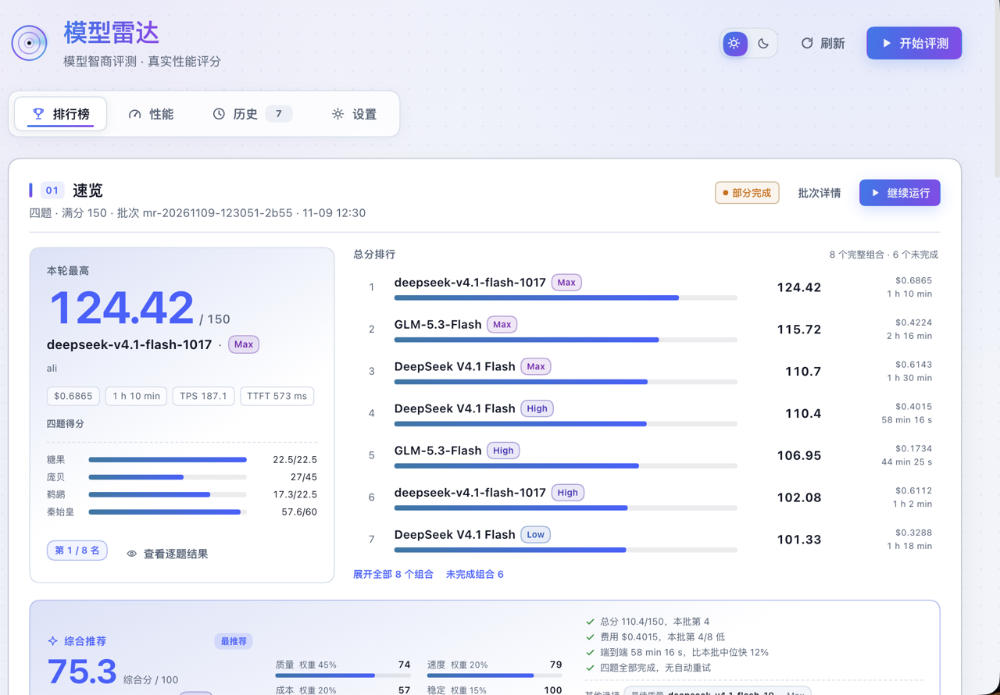
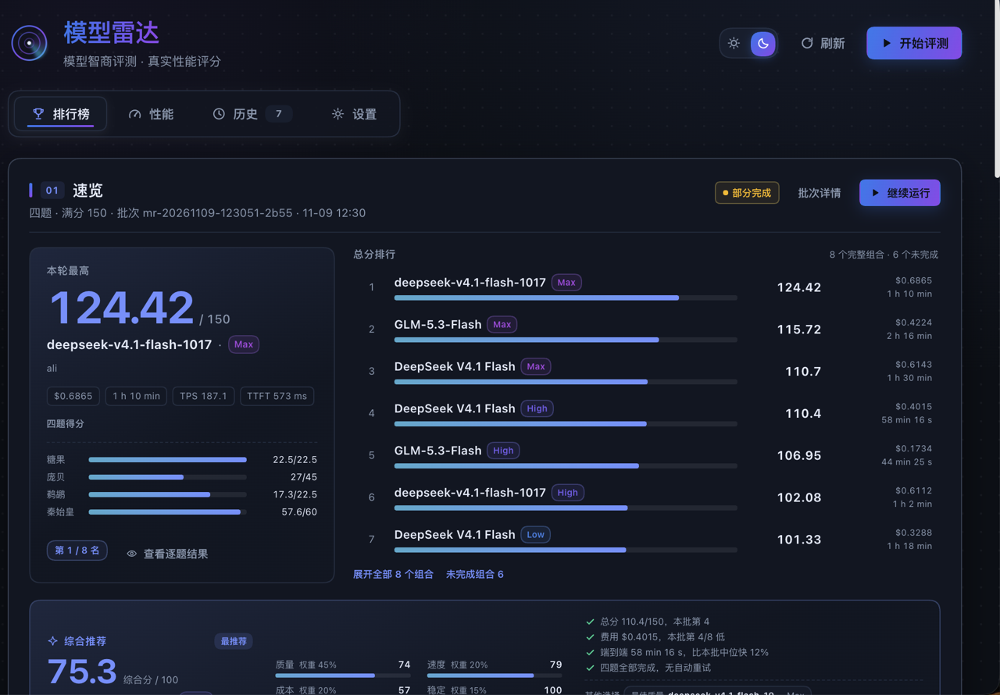
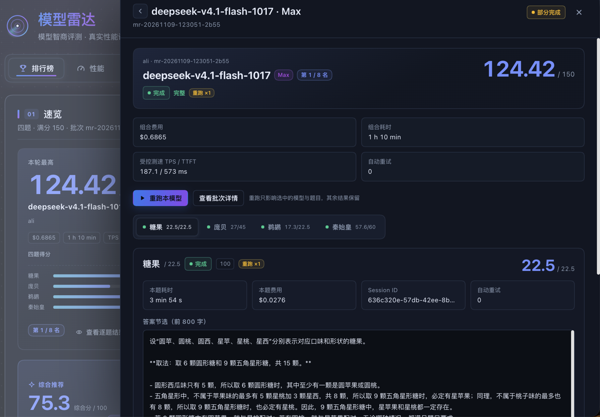
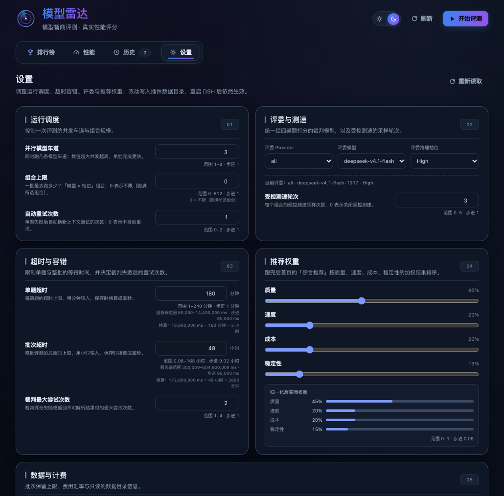
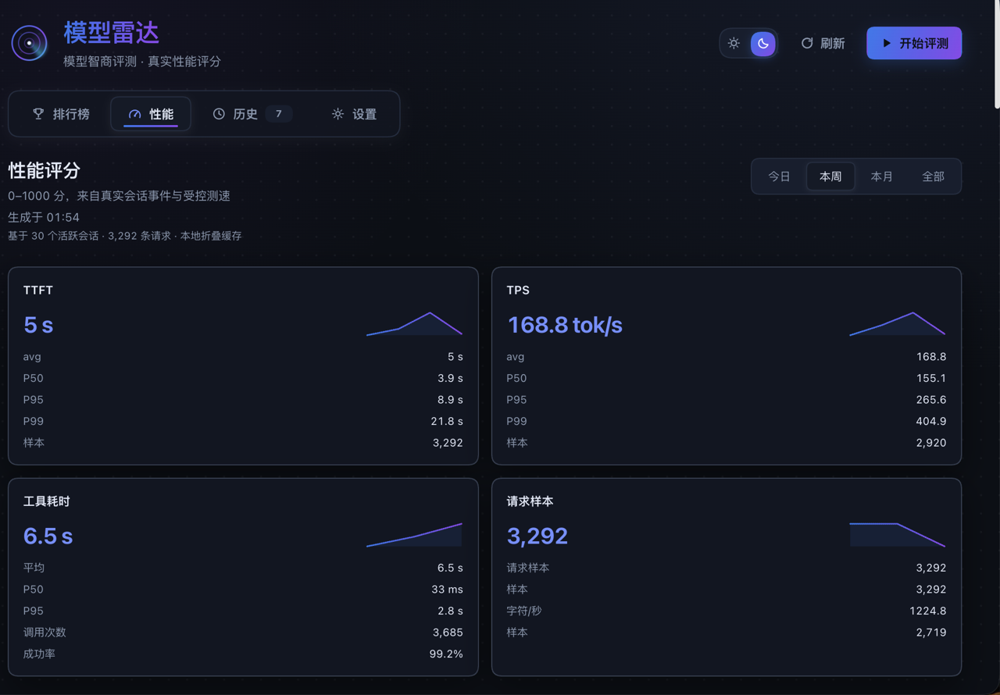

# dsh-model-radar（模型雷达 / Model Radar）

一个独立的 DSH（DeepSeek Harness）插件：**四题 150 分模型智商评测** + **按模型 × 推理档位统计的真实性能评分**。

- 手动勾选「模型 × 推理档位」，跑 codexradar 式四题：秦始皇 60 / 庞贝 45 / 鹈鹕 22.5 / 糖果 22.5。
- 每次评测由**裁判模型**担任会话主模型，各待测模型以**子智能体**方式在自己的全新会话与工作目录中执行任务，结果回传给主模型，跑完后由主模型写批次汇总。
- 自动判分：庞贝 / 糖果程序判定，秦始皇 / 鹈鹕由裁判模型按 rubric 打分。
- 另带 0–1000 真实性能分（TTFT / TPS / 思考速度 / 工具节奏 / 工具耗时 / 工具成功率 / 缓存命中）与基线偏差、受控测速、分位数、会话速度榜。

> 自带会话折叠与性能实现，不依赖其它插件，也不会改动宿主的模型配置。

## 预览

| 排行榜（亮色） | 排行榜（深色） |
|---|---|
|  |  |

| 模型明细（单模型 × 四题 tab + 产物预览） | 设置页 |
|---|---|
|  |  |



> 界面预览使用真实评测数据。

## 来源与致谢（Credits & Prior Art）

本插件的**产品形态与评分思路参考**了下面两个公开项目，谨此致谢。本项目与二者均无隶属关系，未复制其仓库代码；题目沿用公开的四题制式，判分逻辑与评测代码为本仓库独立实现。

- **[Codex Radar](https://codexradar.com/)**（开放众测客户端：[codex-radar/dradar](https://github.com/codex-radar/dradar)）：用真实任务给模型打 0–150「智商分」、按模型 × 推理档位展示成绩、以及庞贝拼图这种「模型动手做、产物可展示」的评测形式，启发了本插件的题库组织、IQ 总榜 / 档位矩阵与产物可视化。四道题的题型与公开题面沿用其公开制式，判分逻辑与评测代码为本仓库独立实现。
- **[Agent Speed](https://github.com/zoefix/agent-speed)**（MIT）：0–1000 性能分、7 维指标（输出速度 / 首字延迟 / 思考速度 / 工具节奏 / 工具耗时 / 工具成功率 / 缓存命中）以及从本地会话日志计算真实性能的思路，直接启发了本插件的性能模块；`lib/perf.js` 为本仓库独立实现。
- **庞贝素材**：题面与拼合参考由本仓库自行生成——底层壁画为 Wikimedia Commons 的公有领域作品 *Still life with eggs, birds and bronze dishes*（庞贝 Julia Felix 之家，公元 50–79 年），切分、题面排版与 gold 邻接由本项目计算，详见 [`assets/pompeii/SOURCE.md`](assets/pompeii/SOURCE.md)。
- 感谢 **DeepSeek Harness** 提供插件运行时、主题 token、会话查询与子智能体能力。

> 名称、链接与截图仅用于致谢与来源说明，不表示上述项目对本插件的背书。

## 许可与素材

- 代码、UI 与文档：MIT（见 [`LICENSE`](LICENSE)）。
- 庞贝题图、拼合参考与 gold 邻接：本仓库自行生成；底层壁画为 Wikimedia Commons 公有领域作品，来源与加工方式见 [`assets/pompeii/SOURCE.md`](assets/pompeii/SOURCE.md)。
- 仓库不包含 RePAIR 等第三方数据集文件，也不依赖任何禁止再分发的素材。

## 界面

侧边栏「模型雷达」→ 整页，四个视图。界面为任务控制台风格（蓝紫科技色、雷达扫描、数字滚动、热力格、点阵 loading），右上角有太阳/月亮主题开关（`toggle-flip` 结构重绘）：首次跟随宿主主题，切换后只影响插件并写入 `localStorage`；全部 CSS/SVG 自绘，无外部 UI 依赖。

1. **排行榜**：按「先看结论、再看证据」排序——
   - 「速览」：左侧**本轮最高**卡（最高分数字滚动、模型 × 档位、较同版本上批涨跌、费用/耗时/TPS/TTFT、四题得分条），右侧**总分排行**紧凑列表（默认 7 行，可展开全部、单独查看未完成组合）；
   - **综合推荐**：综合质量（45%）、速度（20%）、成本（20%）、稳定（15%）计算 0–100 综合分，直接给出「最推荐模型 + 推理档位」，附四条推荐理由与「最佳质量 / 最划算 / 最快」备选；权重可在设置页调整；
   - **档位雷达**热力矩阵（总分/四任务 tabs、模型 × 推理档位、分数热力色，点击格子直接打开该模型对应题目的明细）→ 批次趋势 / 分数 × 费用 / 耗时 Pareto → 裁判汇总 → 最新批次明细（默认折叠，模型/档位、总分、TPS/TTFT、费用、耗时、四题分，可直接「重跑…」）→ 评测口径。
   - **模型明细抽屉**：点排行行/矩阵格/推荐卡打开单模型视图——顶部总分与排名、费用/耗时/TPS/TTFT/重试，四题 tab 切换，逐题看状态/分数/裁判理由/答案前 800 字/评分细节/隔离审计；有产物的题内联预览（SVG/PNG 图片、HTML iframe、源码切换），也可弹窗查看或新标签页打开。底部可「重跑本模型」或「重跑此题」。批次详情模式会列出本批全部组合，点任意组合进入单模型视图。
2. **性能**：范围切换（今日 / 本周 / 本月 / 全部）、组合 0–1000 分卡与 7 维条形、基线偏差、受控测速表、TTFT/TPS 的 avg 与 P50/P95/P99、工具耗时、请求样本数、会话速度榜。报告只在切到该视图时加载（60s 内存缓存 + 按会话日志持久折叠缓存），不会拖慢排行榜首屏。
3. **历史**：批次列表与运行明细；interrupted / stopped / partial 明确标注且不进入趋势。**中断可续跑**：停止、中断、部分完成的批次可在历史、最新批次面板或明细抽屉点「继续运行」，已完成的题目保留，只重跑剩余题目，并在结束后重新生成裁判汇总。**定向重跑**：任意批次可在历史行、最新批次面板、明细抽屉或模型明细里打开重跑弹层，按「组合 × 题目」勾选要重跑的组合与题目（默认勾选失败/未完成的运行），只重跑选中项，其余结果保留。
4. **设置**：运行调度（并行模型数、组合上限、自动重试）、评委与测速（provider/model/档位 + 受控测速次数）、超时容错（单题/单批超时 + 裁判最大尝试次数）、推荐权重（质量/速度/成本/稳定，保存时归一化）、数据与计费（批次保留数、USD→CNY 汇率）。改动写入 `<dataDir>/settings.json` 并立即生效（运行中保存会提示下一批生效），支持恢复默认。

运行中禁用/重载插件会把批次标记为「已中断」并写明原因（可在批次明细看到），重启后自动把上次运行中的批次迁移为「已中断」，都不会再悄悄变成「已停止但没原因」。

「开始评测」弹窗按 provider 分组，每个模型可展开推理档位 chips 多选，显示上下文/输出上限/图片支持等模型信息；**组合数不设上限**（DSH 本身没有这个限制；同时最多跑 `maxParallelModels` 个模型，同一模型的档位/题目串行）；**裁判模型独立选择**（provider → model → effort，默认取配置）；底部实时显示 `N 个组合 × 4 题 = M 次运行`。运行中切换为进度视图：每条模型车道、当前题、完成/失败数、耗时、停止按钮。

## 评分口径（百分制 → 加权 150）

参考 codexradar 的 `codex-four-weighted-150-v2`：每道题先用各自的 rubric 打出 **0–100** 的原始分，再按固定权重折算成总分：

| 题 | 权重 | 折算 | 评分方式 |
| --- | --- | --- | --- |
| 秦始皇（qin） | 60 | `score100 × 0.60` | 裁判 rubric 20 项（A1–F4，合计 100），另有 7 条核心关系完成度门槛：2 条不成立封顶 59、1 条不成立封顶 69、2 条部分成立封顶 69、1 条部分成立封顶 79 |
| 庞贝（pompeii） | 45 | `F1 × 100 × 0.45` | 程序判分：邻接边 F1 直接乘 100 得原始分 |
| 鹈鹕（pelican） | 22.5 | `score100 × 0.225` | 裁判 rubric 14 项（形态 12、腿 4、车架 11、传动 5、坐姿 6、朝向 4、脚踏接触 18、轮/曲柄 10、腿曲柄 10、身体稳定 4、入画 5、文字 3、工艺 5、遮挡可读 3，合计 100） |
| 糖果（candy） | 22.5 | 答对 100 × 0.225，答错 0 | 程序判分 |

总分 = Σ（各题百分制 × 权重 ÷ 100），满分 150。批次里同时保存 `run.score100`（原始百分制）与 `run.score`（折算分），明细里会显示「百分制 X → 折算 Y/权重」；秦始皇还会显示核心关系门槛后的封顶结果。任务/评分版本为 `mr-four-150-v2` / `mr-rubric-150-v2`，与旧批次不混用（旧批次不再显示续跑按钮，需要新建批次）。裁判与候选的输出预算直接读取 DSH 模型配置（示例环境为 128k，实际以所选模型配置为准），插件不写死；裁判超预算/解析失败可退回压缩产物重试，超过 100KB 的产物文本会被截断并标注。

缺产物（没写出 `result.svg` / `index.html` / `model_answer.json`）不再当 0 分：记为 `no-artifact` 失败、组合总分置空，避免“没交付”和“答错”混在一起。模型把输出预算耗在推理上被 max-tokens 截断时，插件会自动追加一次“立即写文件”的续跑；仍失败才记失败。

**耗时不计入分数**：`durationMs` / TPS 只用于性能页展示。因此超时、上游 5xx、裁判 JSON 失败这类“模型能力之外”的失败会按 `autoRetries` 自动用**全新会话（清空上下文）**重跑一次；被丢弃尝试的 token、费用、耗时记入 `run.attempts` / `run.retry*`，最终得分只取最后一次成功尝试。若仍失败，该 run 记为 `timeout` / `error` / `judge_error`，可在批次详情里用定向续跑单独重试。

## 评测隔离与防透题

- **独立会话**：每个候选运行都是独立的 root 会话（不传父 agent、不 seed 父会话历史），只收到「工具规范 + 本题题面」；裁判会话的对话、汇总和此前结果不会进入候选上下文。
- **独立工作目录**：每次运行使用随机命名的独立临时目录（不是同一批次目录下的兄弟文件夹），产物只从自己的目录收集。
- **工具白名单 + 路径围栏**：候选只能用 read/write/edit/glob/grep/read_image/bash（输出上限直接取 DSH 模型配置的 `maxTokens`，当前 128k）；文件工具的绝对路径、相对路径、`..`、软链接都会校验，必须落在本次运行目录内；bash 命令会拦截访问 `~/.dsh`、用户主目录、共享临时根（`$TMPDIR` / `/var/folders` / `/tmp`，防止枚举兄弟运行目录）、插件目录/题库资产（`gold.json`、`reference.png`）、本机插件路由（`dsh-model-radar`、`task-asset`、`/batches`、`/artifact`）以及 `localhost`/`127.0.0.1` 和常见联网客户端。
- **运行期封口**：批次运行中，`/meta` 不返回庞贝 gold 邻接与参考图，`/task-asset?name=reference.png` 与 `/artifact` 返回 404/409，`/run` 与 `/batches/:id` 会剥掉分数、答案、产物和 sessionId，只保留进度视图需要的状态字段。批次结束后的正常查看不受影响。
- **逐题隔离审计**：每次运行结束后回读该会话的 tool call 与 tool result，检查是否出现命中的越界模式（与 bash 黑名单同一套规则）或访问宿主路由、联网，并区分「被工具围栏拦下」和「真正执行」；结论写入 `run.detail.isolation`（`clean` / `blocked` / `suspect` + 证据），在批次明细里可直接看到，`combos[].isolationSuspect` 只标记真正越界的组合。

> 诚实的边界：候选 bash 运行在宿主 `danger-full-access` 下，DSH 的 macOS sandbox 只限制写入、不限制读取与网络，因此字符串围栏和审计属于**检测与降低风险**，不是密码学级隔离。要保证「绝对无法读盘/上网」，需要把候选执行器换成容器/VM（挂载本次运行目录、无网络），这是后续可选的独立改造。

## 性能报告口径

- 性能分来自**本机 DSH 会话日志**，不是只统计模型雷达自己的批次：所选范围内每个模型 × 档位至少约 20 条请求才显示稳定分，因此会读取该范围内所有有请求的会话；雷达批次之外的真实会话也计入。样本不足时仍显示分数，但会标注「样本不足」。
- 报告只在切到「性能」视图时加载；按会话日志的 mtime/size 折叠缓存，未变化的会话不重读。首次冷读需要扫描会话日志（耗时随会话量变化），之后通常约 1 秒；页面会显示「基于 N 个活跃会话 · M 条请求」的口径。
- 如果只想看当天，切「今日」即可；「本周 / 本月 / 全部」逐级扩大样本。

## 四题与判分

| 题 | 满分 | 输入 | 产物 | 判分 |
|---|---|---|---|---|
| 秦始皇 | 60 | 题面原文（内含糖果变体，答案 21） | `result.svg` | 裁判 100 分 rubric（A–F 六类）+ 7 条核心关系门槛 → 折算 60 |
| 庞贝 | 45 | `question.png` + `output_schema.json` + README（子智能体用 `read_image` 查看） | `model_answer.json` | 程序 F1 × 100 分 → 折算 45 |
| 鹈鹕 | 22.5 | 「用 SVG 画一个鹈鹕骑自行车的 2D 动画」 | `index.html`（也接受任意 `*.html`，优先 `index.html`） | 裁判 100 分 rubric（14 项）→ 折算 22.5 |
| 糖果 | 22.5 | 站上独立题面（6/6/5、5/5/3） | 最终文本 | 程序判定 100/0 → 折算 22.5，答案 15 |

- 庞贝 F1：`2TP / (2TP + FP + FN)`，格式错误或空答案为 0；gold 15 条边来自插件内置资产（不随批次快照，修改资产会影响旧批次的展示）。
- 庞贝结果页会把模型答案与 gold 画成邻接图（✓ 正确 / × 错连 / ⋯ 漏连），并附「原始题面」与「真实拼合参考」两张图；参考图只用于结果展示，不会发给候选模型。参考图与节点位置来自本仓库自建的 9 片拼图（见 [`assets/pompeii/SOURCE.md`](assets/pompeii/SOURCE.md)），展示形式参考 codexradar。
- 糖果：优先识别 `\boxed{N}`、`最终答案：N`、`答案：N`、`最少取 N`，最后回退到最后一个整数；等于 15 得满分。
- 秦始皇 / 鹈鹕：严格 JSON 返回；分数越界或非法 JSON、裁判超预算/超时会重试，仍失败记 `judge_error`，该组合总分置空（缺项不补 0），并可按 `autoRetries` 清空上下文重跑。
- 题面版本 `mr-four-150-v2`，rubric 版本 `mr-rubric-150-v2`；每道题先算 0–100，再按权重折算，总分 150。口径变化会断趋势线。
- 跑一个批次会真实消耗候选模型与裁判模型的 token，费用按内置价目表估算后显示；插件不代扣费，也不上传账单数据。

## 裁判 = 会话主模型，待测模型 = 子智能体

每次批次：

1. 用所选裁判模型创建一个主会话（`[模型雷达] 裁判 …`），主模型挂载**无工具**的插件私有 preset，只负责汇总。
2. 每个 **provider × 模型** 是一条车道；同一模型的不同推理档位与 4 道题在车道内串行，不同模型并行（默认最多 3 条，可配置 1–8）。
3. 每个「组合 × 题目」是一个全新子会话（`origin: subagent`、独立 sessionId、每次运行独立的工作目录 `<tmp>/mr-run-<uuid>/`），模型路由为待测模型，工具集固定为文件读写/搜索 + `read_image` + `bash`：
   - 不继承任何前一次运行的上下文；
   - 团队协作、子智能体、计划、网络、插件管理等工具默认可见但被 guard 拒绝，保证公平。
4. 全部结束后把逐题结果与汇总摘要一次性回传给主模型，由主模型写 300 字批次汇总（避免逐条 inject 在主会话里堆积）。
5. 评测会话记录进 `state.json` 的 sessionId 集合，性能分自动排除。

> 为什么庞贝不用「图片直接挂在首条用户消息」：当前 DSH 的 pi-ai 适配器会拒绝从持久历史重放的用户图片（`UNSUPPORTED_CONTENT`）。子智能体先以纯文本启动，再通过 `read_image` 工具查看题图（工具结果里的图片是适配器支持的路径），同时可以用 Python/OpenCV/PIL 辅助分析。

## 安装

需要 DSH Desktop **0.2.2-rc.1 或更新版本**（开发与验证环境为 0.2.2-rc.1）。

从 GitHub 安装：

```bash
dsh plugin --profile desktop add Chip-G0202/dsh-model-radar
```

也可以在 DSH 的「插件 → 发现」里搜索 `Model radar` 安装（收录后可用）。本地开发时安装目录：

```bash
dsh plugin --profile desktop add /path/to/dsh-model-radar
```

安装后刷新页面。**修改插件源码后需要禁用再启用该 bundle（或重启应用）才会重新加载模块。**

> 首次运行：默认不指定裁判。开始评测弹窗会自动选中模型目录里第一个可用 provider / 模型（也可以自己改），设置页可保存固定裁判；若给 `cordis.patch.yml` 填了不存在的 provider，宿主端会退回目录里的第一个可用模型。

## 配置（`cordis.patch.yml` 的 `config`）

| 键 | 默认 | 说明 |
|---|---|---|
| `judge.provider` / `judge.model` / `judge.reasoningEffort` | 空 | 裁判；空 = 启动批次时自动取模型目录里第一个可用模型，可在开始弹窗或设置页改选 |
| `models` | `[]` | 白名单 `provider/model`；空 = 全部已配置模型 |
| `maxCombos` | `0` | 单批组合数上限；0 = 不限制（并发由 `maxParallelModels` 控制） |
| `maxParallelModels` | `3` | 并行模型车道数 |
| `perTaskTimeoutMs` | `10800000` | 单题超时（3 小时，给完整冗余；耗时不计分，只是防挂起） |
| `perBatchTimeoutMs` | `172800000` | 单批超时（48 小时；给 3 小时单题和重试留余量） |
| `autoRetries` | `1` | 因超时/上游错误/裁判失败而重跑的额外次数；每次用全新会话（清空上下文） |
| `judgeMaxAttempts` | `2` | 裁判调用次数（含 1 次重试） |
| `speedRuns` | `3` | 每个组合的受控测速次数，0 = 关闭 |
| `dataDir` | `''` | 空 = `~/.dsh/model-radar` |
| `retentionBatches` | `200` | 批次索引保留数（产物文件不主动删） |
| `perfWeights` | 内置 7 维权重 | 覆盖性能分权重，如 `{ "outputSpeed": 30, "cacheHit": 10 }` |
| `pricing.*` | 内置价目表 | `usdToCny`、`fallbackModel`、`models`、`holidays` |
| `recommend` | `{quality:0.45, speed:0.2, cost:0.2, stability:0.15}` | 综合推荐权重（设置页可调，保存时归一化） |

> 设置页保存的值写入 `<dataDir>/settings.json`，启动时覆盖 `cordis.patch.yml` 的同名字段并成为 effective 配置；删除该文件即可回到配置文件默认值。

## Host 路由

| 方法 | 路径 | 作用 |
|---|---|---|
| GET | `/dsh-model-radar/catalog` | provider → model → 档位/输入模态，5 分钟缓存（`?fresh=1`） |
| POST | `/dsh-model-radar/catalog/refresh` | 清缓存 |
| GET | `/dsh-model-radar/batches` | 批次索引 |
| GET | `/dsh-model-radar/batches/:id` | 单批详情（runs / speedTests / summary） |
| GET | `/dsh-model-radar/report?range=` | 性能报告 |
| GET | `/dsh-model-radar/run` | 当前运行状态/进度 |
| POST | `/dsh-model-radar/run` | 开始（`{ selection, judge }`） |
| POST | `/dsh-model-radar/stop` | 停止（`{ batchId }`） |
| GET | `/dsh-model-radar/task-asset?name=` | 题图 / 参考图（`question.png` / `reference.png`；运行期封口时 404） |
| GET | `/dsh-model-radar/artifact?batch=&run=&file=` | 查看/下载产物（run 形如 `comboKey::taskId`，只允许该 run 的 files） |
| GET | `/dsh-model-radar/settings` | 读取运行时设置（effective / defaults / ranges / locked） |
| POST | `/dsh-model-radar/settings` | 保存设置（`{ values }`）或恢复默认（`{ reset: true }`），越界值 clamp，judge 校验 |
| POST | `/dsh-model-radar/resume` | 续跑/定向重跑（`{ batchId, runIds? }` 或 `{ batchId, comboKeys?, taskIds? }`，无选择时重跑全部未完成运行） |
| GET | `/dsh-model-radar/meta` / `health` | 版本、资产 hash、健康检查 |

## 性能分（0–1000）

按「模型 × 档位」聚合，默认窗口本月：

| 维度 | 权重 | 指标 | 锚点（0 → 100） |
|---|---|---|---|
| 输出速度 | 30 | TPS 中位数 | 20 → 200 tok/s |
| 首字延迟 | 15 | TTFT 中位数 | 12000ms → 500ms |
| 思考速度 | 10 | reasoning 字数/秒 中位数 | 50 → 600 |
| 工具节奏 | 10 | 同回合相邻 tool/call 间隔中位数 | 30s → 2s |
| 工具耗时 | 10 | 单次工具耗时中位数 | 5s → 10ms |
| 工具成功率 | 15 | 成功数 / 总数 | 95% → 100% |
| 缓存命中 | 10 | cacheRead ÷ (input + cacheRead) | 50% → 100% |

- 线性归一后加权和 ×10；样本 < 20 次请求显示「样本不足」+ 临时分。
- 基线 = 前一个等长窗口的同公式分数，显示 `较基线 +x% / -x%`。
- 受控测速：每批次每组合 3 次固定 prompt（`maxTokens: 512`），直接调用 LLM 服务，记录 TTFT / 解码 TPS / 总耗时，取中位数并附 min/max；不进入 150 分总分。

## 数据与隐私

- `~/.dsh/model-radar/state.json`：批次索引 + 评测 sessionId 集合；原子写（临时文件 + rename）。
- `~/.dsh/model-radar/batches/<id>.json`：单批完整记录（答案文本有截断上限）。
- `~/.dsh/model-radar/runs/<batch>/<组合>/<题>/`：每题产物文件的归档副本；子智能体的实际工作目录在系统临时目录（`<tmp>/dsh-model-radar-runs/<batch>/…`），避免候选模型读到其他批次的答案。
- `~/.dsh/model-radar/settings.json`：设置页保存的运行时覆盖（原子写；损坏时静默回退到配置文件默认值）。
- `~/.dsh/model-radar/perf-fold-cache.json`：性能报告的按会话折叠缓存（按会话日志 mtime/size 失效）；首次冷读约 20s，之后约 1s，可随时删除。
- 浏览器只访问同源 `/dsh-model-radar/*`，不接触任何凭据。
- 不修改宿主或其它插件的配置；不发送遥测；仓库不含个人绝对路径与密钥。

## 已知边界

- 单批一次只能跑一个；插件重启时仍为 `running` 的批次标记 `interrupted`，不自动续跑。
- 设置页的 judge 校验发生在保存时；若保存后模型下线，启动下一批时才可能在启动阶段报错（可使用设置页「重新读取」/恢复默认处理）。旧标签页保存设置后需刷新页面才会看到新值。
- 产物支持页内预览（HTML/SVG/PNG/JSON/文本 + 庞贝拼图视图），不提供 CSV/JSON 导出、定时任务、人工改分（按既定方案）。
- pi-ai 适配器拒绝从持久历史重放用户图片，因此庞贝题图由子智能体通过 `read_image` 工具读取（该题可能耗时较长，超时与整批共用 3 小时/48 小时上限）；推理型模型在该题上可能耗时较长，受单题 3 小时超时与批次 48 小时超时约束；批次超时只结束本批（状态记为 error，可「继续运行」），不会再拖垮 Host 进程。
- 本地隔离是 **best-effort**：文件工具的读写会被 guard 限制在本次运行目录内（拒绝 home 路径、`.dsh`、`..`、软链接越界与兄弟运行目录）；bash 是**黑名单拦截**而非路径围栏，不在黑名单里的绝对路径读取（如 `/etc/passwd`）不会被拦。两者都只是插件级拦截，不是 OS 沙箱；评测期间不要把标准答案或参考实现放进候选可读的目录。
- 插件在激活时注册两个私有 agent preset（`model-radar-bench` / `model-radar-judge`）；若运行环境没有 agent preset 服务，批次会拒绝启动并给出 `preset-unavailable`。

## 开发与测试

```bash
for f in index.js client.js lib/*.js; do node --check "$f" || exit 1; done
node --test test/
```

单元测试覆盖目录/批次存储、评分、裁判 JSON 解析、隔离审计、性能折叠与设置校验，全部通过后才会发布。

`test/fixtures/pompeii-answers.json` 只保留 4 条匿名化答案与对当前 gold 的期望 F1，用于回归。

## 结构

| 文件 | 作用 |
|---|---|
| `index.js` | Host：Config、路由、私有 preset 注册、生命周期 |
| `lib/catalog.js` | provider / model / 档位目录与选择校验 |
| `lib/tasks.js` | 四题题面、资产、rubric、产物收集 |
| `lib/runner.js` | 批次队列、裁判主会话、子智能体会话、超时/停止、汇总 |
| `lib/judge.js` | 裁判调用与严格 JSON 解析 |
| `lib/scoring.js` | 庞贝 F1、糖果答案、组合总分与缺项规则 |
| `lib/perf.js` | 会话折叠、模型×档位指标、0–1000 分、基线、分位数 |
| `lib/pricing.js` | 价目表与费用估算 |
| `lib/store.js` | JSON 结果库（原子写、批次索引、评测会话排除） |
| `client.js` | 浏览器半边：侧边栏页、四个视图（排行/性能/历史/设置）、评测弹窗与进度、重跑弹层、模型与批次明细抽屉 |
| `lib/settings.js` | 运行时设置：默认值、clamp、推荐权重归一化、judge 校验、原子读写 |
| `assets/pompeii/` | 庞贝题图、拼合参考图（仅展示用）、schema、README、gold、素材来源说明 |
| `locale/*.json` | 插件列表标题/描述（中英） |
| `icon.svg` / `assets/icon/*.png` | 插件图标与市场卡片位图 |
| `screenshots.json` | 市场截图清单（5 张） |
| `LICENSE` | MIT |
| `test/` | 单元测试（131 项） |
| `.github/workflows/ci.yml` | 语法检查 + 单元测试 |

---

## English summary

`dsh-model-radar` is a standalone DSH plugin that benchmarks every configured model route on a four-task, 150-point suite (Qin 60, Pompeii 45, Pelican 22.5, Candy 22.5) and scores real-world performance per model × reasoning effort on a 0–1000 scale. The product shape and metric ideas are credited to [Codex Radar](https://codexradar.com/) (open client: [codex-radar/dradar](https://github.com/codex-radar/dradar)) and [Agent Speed](https://github.com/zoefix/agent-speed); this repository is an independent implementation with no affiliation to either project.

The selected judge model runs as each batch's main session; every candidate combination runs as a fresh subagent session with its own working directory and a fixed file/`read_image`/`bash` toolset. Results flow back to the judge, which writes the batch summary. Scoring is programmatic for Pompeii (F1) and Candy, and rubric-based for Qin and Pelican. Batches, artifacts, speed tests and the 60-second-cached performance report are stored locally under `~/.dsh/model-radar`; the browser only talks to same-origin `/dsh-model-radar/*` routes. No credentials reach the browser and no other plugin's configuration is modified.